# ATLAS

Local-first mission control for autonomous software engineering. You open a repository and describe an outcome. ATLAS proposes a plan for you to approve, runs an agent in an isolated git worktree through policy-governed tools, verifies the result independently, and shows you the evidence. You accept or reject the change. Your checkout is never edited.

> An agent claim is not evidence. ATLAS marks work verified only on a real process exit, test assertion or operator decision.

This is **v0.1, milestones M0 + M1** of the [implementation manual](docs/spec/manual.md). See [what works and what doesn't yet](docs/spec/status.md).

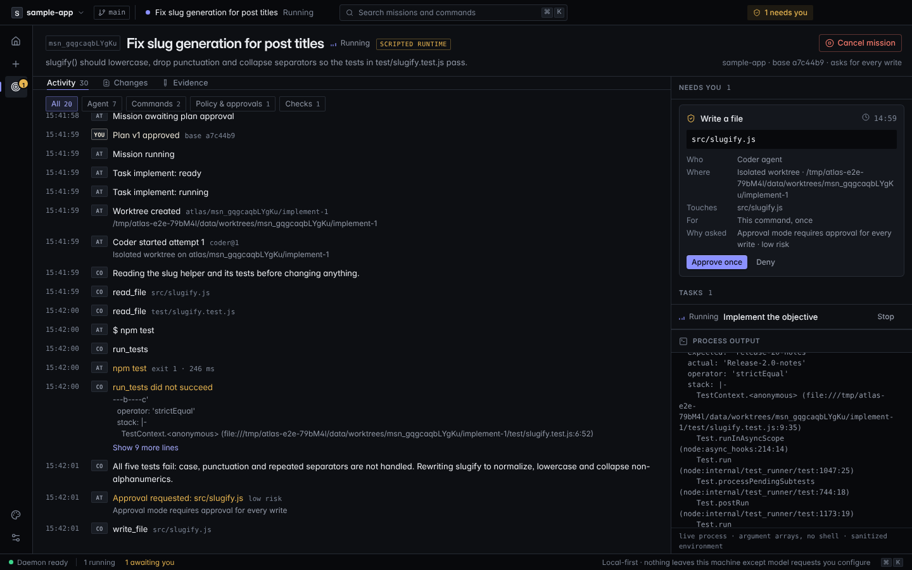

## Product tour

Every screenshot below was captured from the built Electron app running a real mission on the bundled sample project (`pnpm screenshots` regenerates them). The agent is the scripted runtime; the git worktree, commands, test runs, approvals and evidence are real.

### Projects
Open any local folder with **Open repository** (⌘O). Each project card shows the real branch, HEAD, uncommitted-change count and its missions with their outcome. An empty state explains what ATLAS will and won't touch.

| Empty | With a project |
| --- | --- |
| 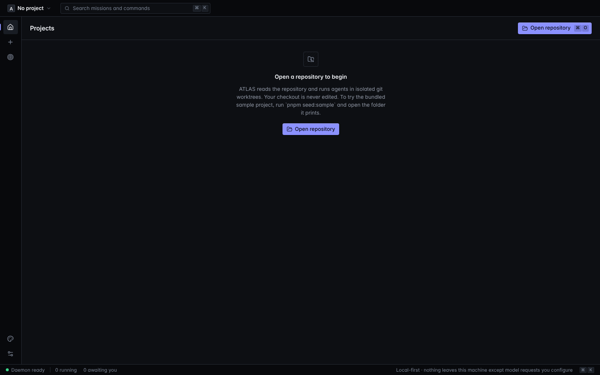 | 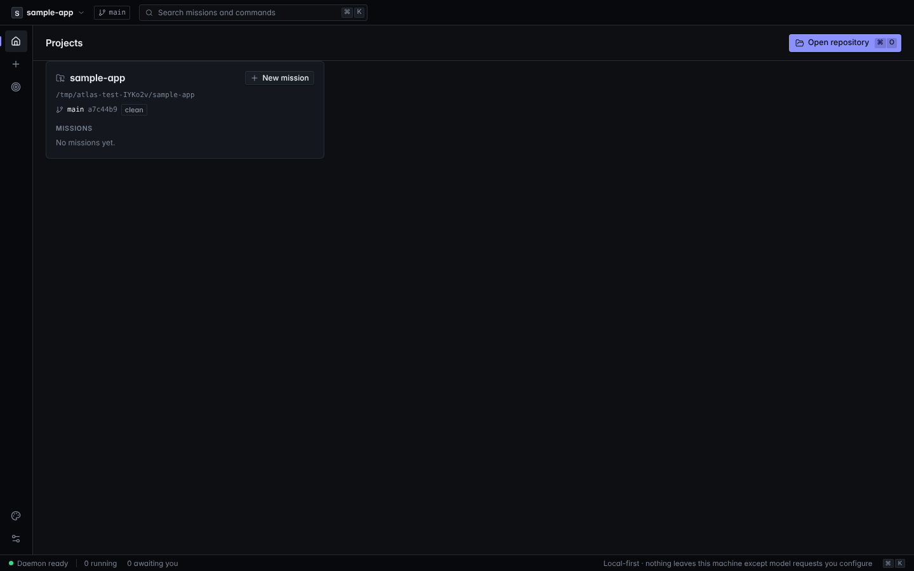 |

### Mission composer with preflight
Choose the repository, describe the outcome, add constraints, then pick an **approval mode** (ask for risky actions · ask for every write · read-only) and a **runtime** (scripted, or Pi when a provider key is set). **Preflight** runs live as you change options and blocks on real problems: not a git repo, no commits, runtime unavailable. It warns about uncommitted changes, missing tests and the absence of a deploy target.

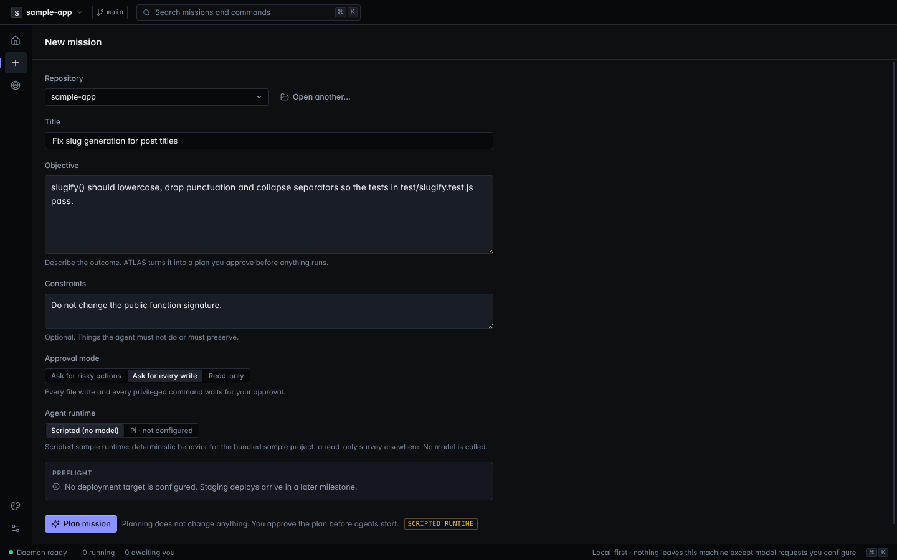

### Plan review before anything runs
The validated plan lists each task, its acceptance criteria, the exact tools it may request, what will ask you first, and how ATLAS will verify the result. Nothing executes until you approve it.

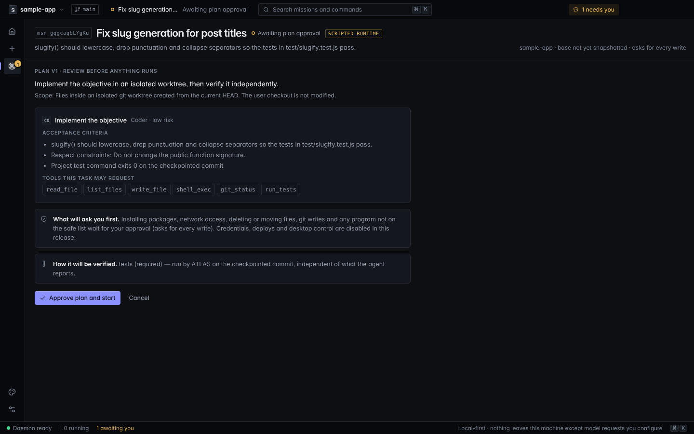

### Live execution and approvals
- **Needs you**: each approval card states *who* (agent role), *what* (the exact path or command), *where* (worktree), *what it touches*, *for how long* (once) and *why it was asked*, with a live expiry countdown. Approve once or deny.
- Pending decisions surface everywhere: a **"needs you" chip** in the title bar, an amber rail badge, the **status bar count**, the **window title** (`(1) … — ATLAS`), and a toast if you're on another screen.
- **Process output** streams the real stdout/stderr of each command, with exit codes and durations.
- **Tasks** shows state and attempt number, with a per-task **Stop** and a mission-level **Cancel** that kills the whole process tree.

### Activity timeline
An ordered, resumable audit trail: plan, policy denials, tool calls, commands, checkpoints, checks and your decisions, each with actor and time. **Filter chips** (All · Agent · Commands · Policy & approvals · Checks) show live counts. Long output such as stack traces **collapses** with a "Show N more lines" expander. Agent summaries are labeled *a claim, not evidence*.

| Full timeline | Filtered to policy & approvals |
| --- | --- |
| 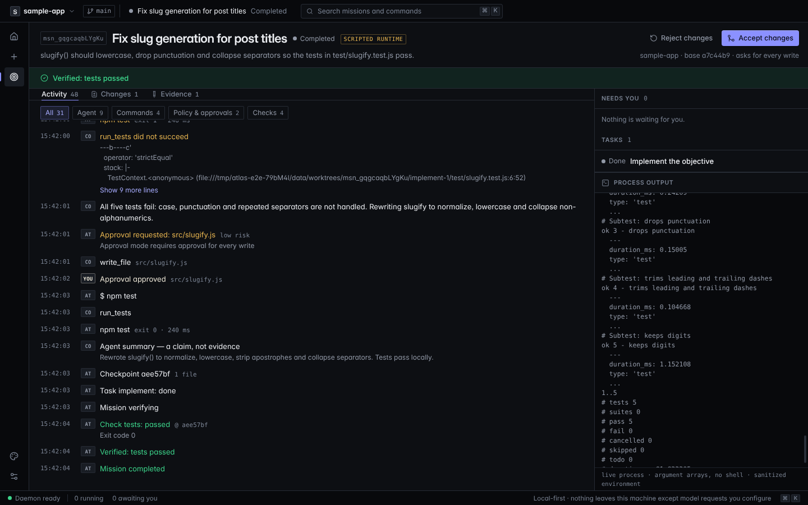 | 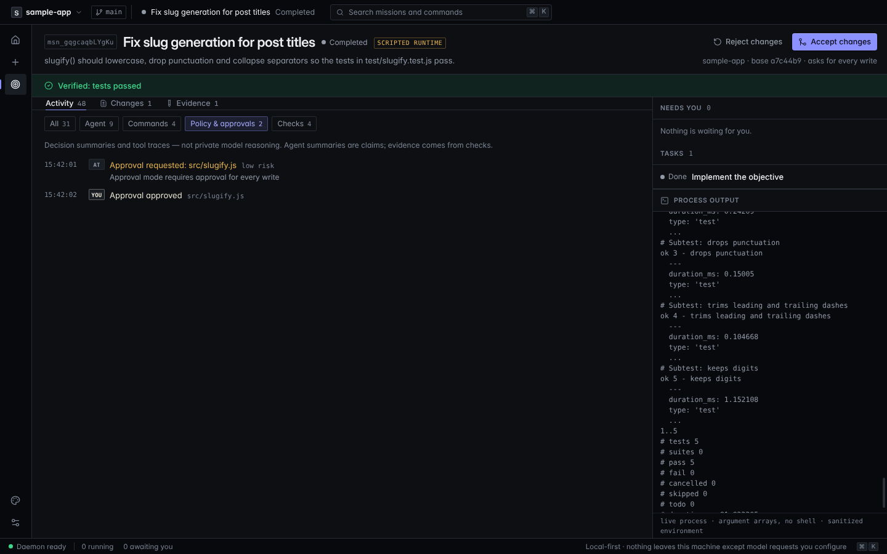 |

### Changes and evidence
**Changes** renders the checkpointed patch per file, with +/− counts and branch/base identity. Untrusted content is always shown as text, never HTML. **Evidence** shows the release-gate verdict in words, each check's result, command, commit, duration and full log, plus an explicit list of what this release does **not** verify. **Accept** keeps the branch for you to merge; **Reject** removes the worktree and branch. Neither touches your checkout.

| Changes | Evidence |
| --- | --- |
| 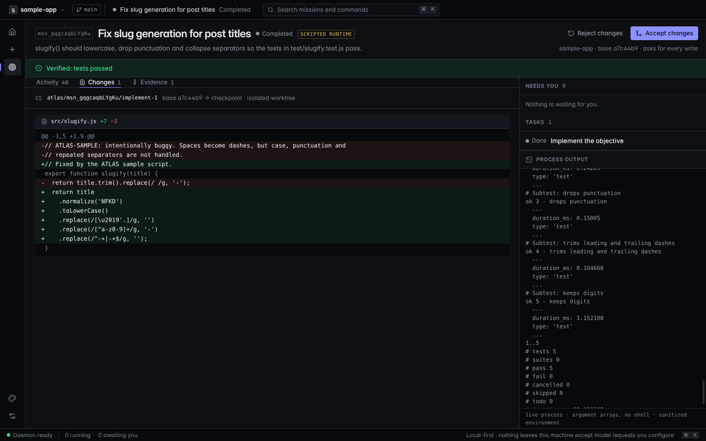 | 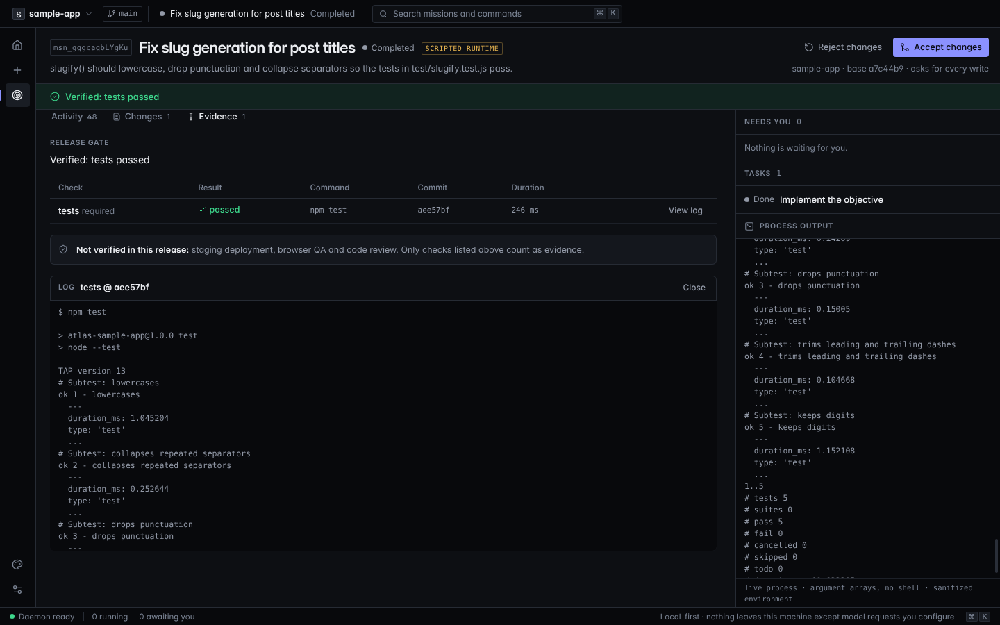 |

### Command palette (⌘K)
Jump to any mission (fuzzy search over titles, IDs and objectives), start a mission in a specific project, open a repository or go to any screen. Missions waiting on you are listed first. Fully keyboard-driven: ↑ ↓ ↵ esc.

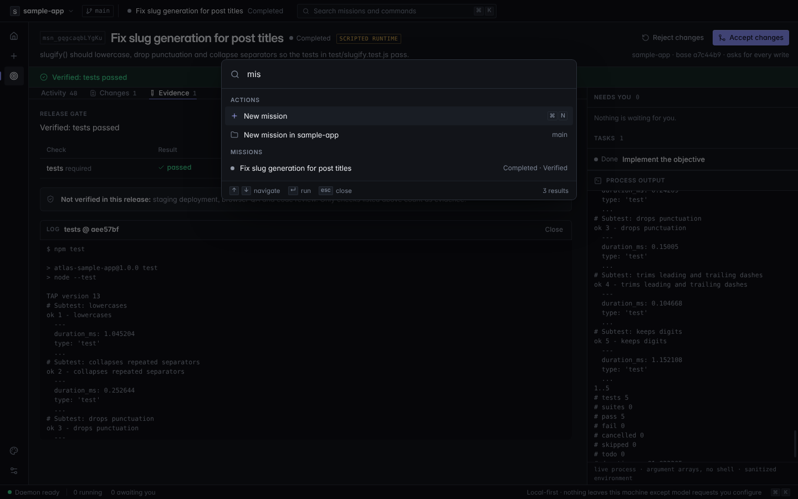

### Settings
Health of each runtime, provider keys stored with the OS credential store (never shown again, redacted everywhere), and versions with Pi provenance (package, commit, license).

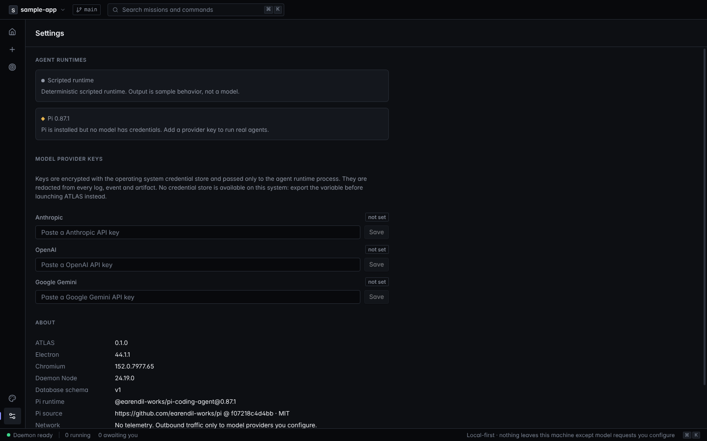

### Design preview
The full design-system prototype (multi-agent graph, inspector, terminals, deploy studio and more) stays available from the rail, under a persistent banner that says it is sample data. It shows where the product is heading in M2–M5.

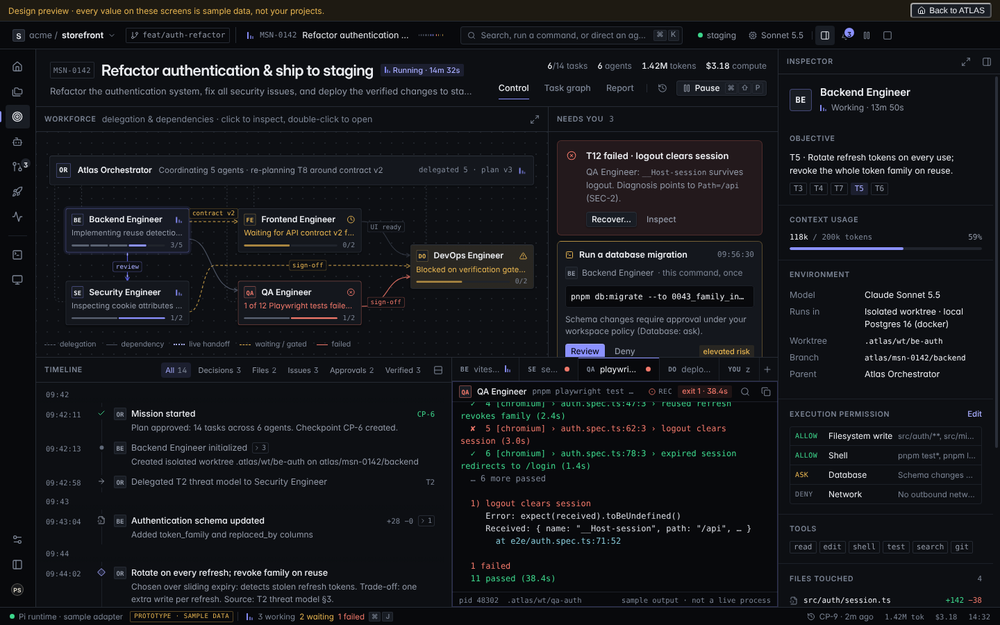

### Interaction details
- **Keyboard**: ⌘K palette · ⌘O open repository · ⌘N new mission · ⌘1 projects · ⌘, settings (Ctrl on Linux/Windows).
- **Resilience**: if the daemon crashes, the status bar shows *Daemon restarting*, the shell restarts it, and every open view resyncs from the event log with no gaps or duplicates. App restarts restore the last screen.
- **Honest states**: verified (green) only on a passing required check; *unverified* (amber) when no checks exist; *failed* (coral) otherwise. Every state carries a word or glyph, never color alone.
- **Design system**: dark, near-monochrome "Obsidian" theme; Inter / Inter Display / DejaVu Sans Mono; one accent per view; hairline separation; 4px grid. See [docs/design/DESIGN.md](docs/design/DESIGN.md).

## Quick start

```bash
corepack enable          # pnpm 10
pnpm install
pnpm doctor              # checks Node ≥ 22.19, git, Electron, credentials (values never printed)
pnpm seed:sample         # creates ~/atlas-sample-app: a small project with a real bug and real tests
pnpm dev                 # launches the desktop app
```

In the app: **Open repository** → choose `~/atlas-sample-app` → **New mission** → describe the fix → **Plan mission** → review the plan → **Approve plan and start**. Watch the agent read the code, run the failing tests, edit `src/slugify.js` in its own worktree and re-run them. ATLAS then runs the tests itself on the checkpointed commit and shows **Verified: tests passed**, the diff and the logs. **Accept changes** keeps the branch `atlas/<mission>/implement-1` in your repository for you to merge. **Reject changes** removes it.

The sample mission uses the **scripted runtime**, which needs no model or credentials. Its tool calls, commands and checks are real; only the decisions are scripted, and the UI labels it. To run a real model, add a provider key in **Settings** (Anthropic, OpenAI or Google; stored with the OS credential store) and choose **Pi** when creating a mission.

## What a mission does

1. **Preflight** warns about uncommitted changes, missing test commands, missing credentials and the absence of a deploy target.
2. **Plan**: a validated plan (tasks, acceptance criteria, tools, verification). Nothing runs until you approve it.
3. **Execute**: the agent works in `<data>/worktrees/<mission>/<task>` on a new branch from your HEAD. Every tool call passes the policy engine:
   - reads, edits inside the worktree and safe commands (`npm test`, `git status`, …) run directly;
   - installs, network clients, deletes, git writes, shells and unknown programs wait for a **single-use approval** that states who, what, where, what it touches, for how long and why;
   - `sudo`, path escapes, `.git` writes, deploys, credentials and desktop control are denied.
4. **Verify**: ATLAS detects the project's checks (`test`, `typecheck`, `lint` scripts), runs them on the checkpointed commit, and the release gate reports *verified*, *unverified* (no checks) or *failed*. Only a pass satisfies a required check.
5. **Decide**: accept (branch kept) or reject (worktree and branch removed).

Every step is an append-only event with actor, task, attempt and time. The timeline, process output, diff and check logs all come from that record. Closing the app, crashing the daemon or restarting resumes from it.

## Commands

| | |
| --- | --- |
| `pnpm dev` | Electron + Vite with live reload |
| `pnpm build` | renderer (Vite) + main, preload and daemon (esbuild) |
| `pnpm typecheck` / `pnpm lint` | strict TS per workspace; ESLint + dependency-graph check |
| `pnpm test` | unit tests — policy, state machines, plan validation, gate, storage, paths, executor, Pi contract |
| `pnpm test:integration` | full missions against temp git repos (approvals, denial, redaction, cancel, crash recovery) |
| `pnpm test:e2e` | Playwright drives the built Electron app (Linux: `xvfb-run -a pnpm test:e2e`) |
| `pnpm package` | electron-builder → `apps/desktop/release/` (Linux AppImage is the tested target) |
| `pnpm screenshots` | rebuilds and recaptures `docs/screenshots` from a live mission |
| `pnpm pi:version` | verifies the pinned Pi SDK (0.87.1, MIT) |

No test needs network access or model credentials. Pi's contract tests run the real SDK against its scripted provider.

## Architecture

```
renderer (React, sandboxed) ──intent──▶ preload (frozen window.atlas) ──▶ main (validates sender + zod schema)
                                                                              │
                                              ordered events ◀── daemon (utility process) ◀┘
                                                                 ├─ storage: SQLite (WAL) + checksummed artifacts
                                                                 ├─ orchestrator: plan → schedule → ToolGate → verify → gate
                                                                 ├─ policy: capabilities, approvals (default deny)
                                                                 ├─ workspace: worktrees, path checks, checkpoints
                                                                 ├─ terminal: argv executor, env allowlist, tree kill
                                                                 └─ runtimes: scripted · Pi SDK (behind AgentRuntime)
```

[AGENTS.md](AGENTS.md) maps the code. Decisions are in [docs/adr](docs/adr); the visual language is in [docs/design](docs/design/DESIGN.md). The design-system prototype is still in the app under **Design preview** (rail, palette icon) and is labeled as sample data.

## Security model in one paragraph

The renderer has no Node access and can only send declared, schema-validated intents. Main checks that they come from its own window. The daemon re-validates them and owns all execution. Agents never get a shell: they get six governed tools, policy is code evaluated before every call, and denied calls never reach an executor. Commands are argument arrays with a scrubbed environment, so provider keys and cloud credentials are not inherited. Secrets are redacted from events, logs and artifacts. **v0.1 does not provide OS-level sandboxing**: an approved or safe-listed command such as the project's own test script runs as you. See [ADR 0005](docs/adr/0005-isolation-limits.md).

## Platform

Linux x64 is the tested platform; CI runs the Electron e2e suite there. macOS and Windows builds are configured but untested and unsigned. Requires Node ≥ 22.19 and git.
